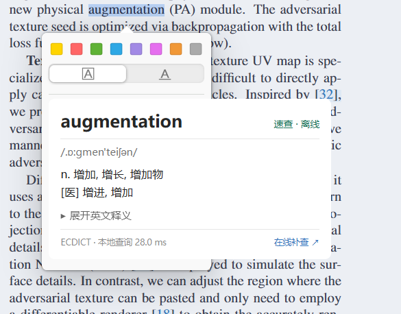

# QuickLex

[简体中文](README.md) | **English**

An offline **English–Chinese dictionary for Zotero 10.0**. Double-click an English word to see Chinese definitions in Zotero’s native selection popup, with pronunciation, multiple senses, inflections, and expandable English definitions. **Windows, Intel Macs, and Apple Silicon Macs use the same XPI.** Automatic lookup requires no network connection or API key.

**The default `main` branch is the regular English–Chinese edition, version 0.3.1, bundling ECDICT only.** Russian lookup and DSL import are maintained separately on [`russian`](https://github.com/vbcnft59/zotero-quicklex/tree/russian).

| Edition | Features | Download |
| --- | --- | --- |
| Regular `main` (default) | Offline English → Chinese | [v0.3.1](https://github.com/vbcnft59/zotero-quicklex/releases/tag/v0.3.1) · `quicklex-0.3.1.xpi` |
| `russian` branch | English–Chinese + Russian–Chinese, optional DSL import | [v0.3.0](https://github.com/vbcnft59/zotero-quicklex/releases/tag/v0.3.0) · `quicklex-0.3.0.xpi` |

Both editions share an add-on ID; installing one switches editions.

## Installation: Windows / macOS

1. Download **`quicklex-0.3.1.xpi`** from **Assets** on the [regular v0.3.1 release](https://github.com/vbcnft59/zotero-quicklex/releases/tag/v0.3.1). Do not extract it.
2. In **Zotero desktop → Tools → Plugins** (or Add-ons), click the gear menu and choose **Install from file**. On macOS, Tools is in the menu bar at the top of the screen.
3. Select the XPI. It can replace an earlier version or the Russian edition; restart Zotero if necessary.
4. Open a PDF with selectable text and double-click `novel` or `analyses`. Selecting a single word by dragging also works.
5. **Tools → QuickLex 速查 → 查一个单词…** (Look up a word…) supports manual lookup; the same menu toggles automatic definitions.

Requires **Zotero 10.0.x**. GitHub **Source code (zip/tar.gz)** downloads are development source; install the `.xpi`. A `.sha256` checksum accompanies the release.

Updates are manual, and the plugin disables its own background updates. The reserved `quicklex.invalid` update address is a placeholder; checking for updates manually will fail. The installation fix from 0.1.1 is retained. If another translation plugin opens a popup, you can disable its automatic lookup. Disable or remove QuickLex through Zotero’s plugin manager.



## Features

- **Offline English–Chinese data:** [ECDICT](https://github.com/skywind3000/ECDICT), with 399,213 headwords and 56,954 form-index keys. Preserves source pronunciation, Chinese senses, and English definitions.
- **Fast loading:** Asynchronously preloads 8,000 common words; remaining data uses 256 on-demand shards. Caches up to 2,048 results and 24 shards, sharing concurrent reads.
- **Inflections:** Retains exact meanings alongside indexed base forms, such as `found` / `find` and `leaves` / `leaf` / `leave`. Suffix guesses are marked as possible base forms.
- **PDF normalization:** Handles case, some punctuation, soft hyphens, ligatures, and line breaks. Long definitions scroll; English definitions expand on demand.
- **Optional online lookup:** Only clicking a button opens Youdao. Automatic lookup does not send words, PDFs, or surrounding text.

The regular edition does not load Russian data or expose Russian/DSL menus. Cached Russian build outputs left after a branch switch are excluded from its XPI. Previously imported Russian dictionaries are left untouched and unused, so switching back to the Russian edition preserves them.

Source errors and omissions may remain. QuickLex does not choose senses from context or provide sentence/general phrase translation or OCR.

## Performance and validation

[Version 0.3.1 benchmark](docs/benchmark-0.3.1.json): Windows, Node.js 24, Ryzen 9 8945HS, 20 English words. Empty plugin-cache queries: median **2.347 ms**, P95 **5.405 ms**; first mixed queries after preload: median **0.085 ms**; cached queries: median **0.001 ms**.

**These figures measure Node.js file access and lookup only; OS disk caches may be warm. They exclude XPI decompression, Zotero’s popup delay, DOM rendering, and painting, and are not a comparison with another plugin.** The card timer does not represent the complete double-click response time.

Tests cover meanings, inflections, caching, retries, shutdown, macOS paths, and English-only package boundaries. [GitHub Actions](https://github.com/vbcnft59/zotero-quicklex/actions) checks Windows, Linux, macOS Apple Silicon, and macOS Intel. Both Mac jobs also load the XPI in official Zotero 10.0.6 with isolated profiles and empty libraries, checking real-DOM lookup and English-only controls. See the [0.3.1 validation record](docs/validation-0.3.1.md), in Chinese. Programmatic callbacks do not replace full testing of physical PDF double-clicks, different windows, or other plugins.

## Development

Requires Python 3.10+ and Node.js 18+, without npm dependencies. Use `python` on Windows, or typically `python3` on macOS/Linux:

```sh
python3 scripts/download_sources.py
python3 scripts/build_dictionary.py
npm test
node scripts/benchmark.cjs
python3 scripts/package.py
python3 -m unittest discover -s tests -p "test_*.py"
```

The first step downloads only pinned ECDICT data, checked by SHA-256. Later steps work offline. Output is `dist/quicklex-0.3.1.xpi` and its checksum. Generated data is not committed; release XPIs bundle the English dictionary. To build the Russian edition, switch to `russian` and follow that branch’s README.

Native checks create an isolated profile and empty library, without using your personal profile. For example, on macOS:

```sh
python3 scripts/native_smoke.py --executable /Applications/Zotero.app/Contents/MacOS/zotero
```

For the browser preview, run `python3 -m http.server 8765 --bind 127.0.0.1` and open `http://127.0.0.1:8765/demo/`. It shares the plugin’s English dictionary and card code.

## License

Plugin code and bundled ECDICT use MIT. See [LICENSE](LICENSE) and [third-party notices](THIRD_PARTY_NOTICES.md). Sources and licenses for the Russian edition remain on [`russian`](https://github.com/vbcnft59/zotero-quicklex/tree/russian).
