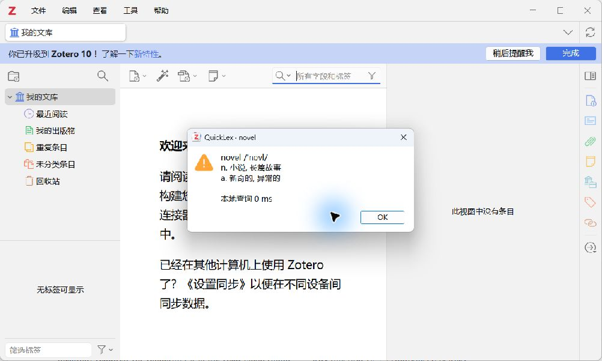

# QuickLex 速查

面向 **Zotero 10.0（已在 10.0.6 验证启用与手动查词）** 的英汉离线查词插件。优先解决选词后等待在线翻译服务的问题。

**当前为 0.1.1 公开试用版。** 已完成客户端启用与手动查词验证；PDF 双击选词弹窗仍待完整实机验证。欢迎通过本仓库 Issues 反馈，并附上 Zotero 版本、操作系统和复现步骤。

在 Zotero 内置阅读器里双击英文单词，中文释义直接显示在原生选词弹窗中。拖选单个词也可以触发；整句和多词短语不会触发。本插件无需 API Key，词典随 XPI 安装，自动查词无需网络。

## 安装

1. 打开本仓库右侧的 **Releases**，进入 **v0.1.1**，在 **Assets** 中下载 **`quicklex-0.1.1.xpi`**，无需解压。若此前安装 0.1.0 时提示不兼容，请改用此版本。
2. Zotero → 工具 → 插件（或“附加组件”）→ 右上角齿轮 → 从文件安装插件，选择这个 XPI。
3. 打开一篇可选中文字的英文 PDF，双击 `novel`、`binding` 等词进行试用。
4. 工具 → QuickLex 速查中，可以开关自动释义，也可以“查一个单词…”检查词库是否可用。

若已有翻译插件同时弹窗，可关闭旧插件的自动查词功能后对比。QuickLex 可以通过 Zotero 插件管理器停用或卸载。

0.1.1 修复：补齐 Zotero 10 安装器强制要求的 HTTPS `applications.zotero.update_url` 字段。0.1.0 缺少此字段，安装器报 `ERROR_CORRUPT_FILE (-3)`，界面显示通用的“可能无法与该版本的 Zotero 兼容”提示。此试用版通过新的 XPI 手动更新；启动时关闭本插件的后台自动更新。清单使用保留域名 `quicklex.invalid` 占位，没有自动更新服务，手动检查此插件更新会失败。

下载时请选择 `.xpi` 安装包。GitHub 的 **Source code (zip/tar.gz)** 是开发源码，不是可直接安装的插件。Release 同时提供 `.sha256` 文件以核对下载包完整性。



## 这版实现的功能

- **399,213 个本地词条**：来自 [ECDICT](https://github.com/skywind3000/ECDICT)，保留词库提供的中文释义、音标和英文释义。
- **常用词预加载**：启动时异步载入 8,000 个常用词，其余词条分为 256 个均衡的小文件，按需读取。
- **重复查词缓存**：最多缓存 2,048 个查询结果和 24 个词典分片，并合并相同查询的并发读取。
- **多义项**：显示词库已有的各词性与释义，不裁掉后面的中文义项；较长内容可滚动，英文释义可展开。
- **词形还原**：使用源词库构建的 56,954 个变形词索引键；保留原词释义并补充原形，例如 `found` 同时显示“建立”和 `find` 的释义，`leaves` 可以查到 `leaf`、`leave`。缺少索引时尝试简单词尾规则，并明确标注“可能的原形”。
- **PDF 选词处理**：规范大小写、部分标点、软连字符、连字及换行断词。
- **在线补查**：只有主动点击“在线补查”，才会在浏览器打开有道词典并发送当前单词。

## 速度验证与兼容性边界

2026-10-14，在本机 Node.js 24 / Windows / Ryzen 9 8945HS 上，以 20 个常见与学术词测试同一查词引擎：

| 情况 | 中位数 | P95 |
| --- | ---: | ---: |
| 插件缓存为空，读取分片并解析 | 2.338 ms | 5.115 ms |
| 完成常用词预加载后的首轮混合查询 | 0.098 ms | 2.688 ms |
| 查询结果已缓存，重复查询 1,000 次 | 0.002 ms | 0.004 ms |

预加载耗时 23.044 ms。原始基准记录见 [docs/benchmark.json](docs/benchmark.json)，可运行 `node scripts/benchmark.cjs` 重新测量，新的结果写入本地 `artifacts/benchmark.json`。

**这些数字只反映 Node.js 中的文件读取和查词逻辑；操作系统磁盘缓存可能已热。它们不包含 XPI 解压、Zotero 原生选词弹窗等待、DOM 渲染或屏幕绘制，也没有与原有插件做实测比较。实际体验以安装后的 Zotero 为准。** 卡片底部显示的是本插件收到选词事件到填入释义的耗时，也不代表从双击到屏幕显示的完整时间。

开发时核对了 [Zotero 10 开发说明](https://www.zotero.org/support/dev/zotero_10_for_developers) 和本机 10.0.6 的接口源码。0.1.1 已在真实 Zotero 10.0.6 的独立配置与空文献库中完成安装包解析、启用、菜单注册与本地查词验证：安装错误码为 0，`isCompatible=true`，插件 `active=true`，`appDisabled=false`，`novel` 能返回“小说”“新奇的”等义项。19 项自动化测试全部通过。PDF 阅读器中双击选词的弹窗仍需进一步实机联调。

验证摘要见 [docs/validation.md](docs/validation.md)。上图为独立空文献库中实际手动查词的结果；阅读器双击弹窗的显示方式应以安装后的客户端为准。

本插件用于单词词典查询。专业术语覆盖、释义准确性和完整性受 ECDICT 数据限制；不会根据论文上下文自动判定义项，也不提供整句翻译、扫描 PDF 的 OCR 或完整短语翻译。部分英文词有多个中文义项，但源词库的条目并非权威词典的完整收录。

## 本地开发

无需 npm 依赖。需要 Python 3.10+ 与 Node.js 18+。

```powershell
python scripts/download_sources.py
python scripts/build_dictionary.py
node --test tests/core.test.cjs tests/runtime.test.cjs tests/manifest.test.cjs
node scripts/benchmark.cjs
python scripts/package.py
```

第一步下载公开词典及许可证，需要联网；其他步骤可以离线运行。数据版本与 SHA-256 固定在脚本中，校验不符时构建会终止。构建结果为 `dist/quicklex-0.1.1.xpi` 及对应校验文件。可选的 `python scripts/download_sources.py --references-only` 用于下载官方接口参考源码，不是构建的必要步骤。

仓库不包含生成后的词典分片；它们由构建脚本从固定版本的 ECDICT 转换生成，并随 Release 中的 XPI 一起分发。源码压缩包的使用者需要先运行上述构建步骤。

卡片浏览器预览（用于开发，不代表已完成 Zotero 联调）：

```powershell
python -m http.server 8765 --bind 127.0.0.1
```

打开 `http://127.0.0.1:8765/demo/`。预览与插件共用 `core.js`、`card.js` 和编译词库。

如该端口被占用或系统保留，可改用其他本机端口。停止预览服务可在终端按 `Ctrl+C`。

目录：`addon/` 为插件源文件；`scripts/` 为下载、编译、基准测试与打包脚本；`tests/` 覆盖选词处理、真实多义词、词形还原、缓存、读取失败重试、快速切换单词和卸载清理。

插件采用 MIT 许可，词典的 MIT 许可与来源信息随安装包附带，见 `THIRD_PARTY_NOTICES.md`。
